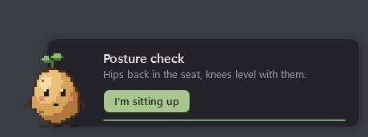
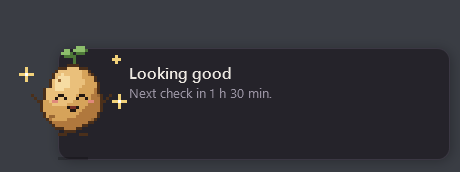
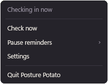
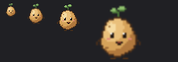

# Posture Potato

A small Windows tray app. Every so often a pixel-art potato pops out of the corner of your screen to ask you to check your posture.



## Using it
- **Pop-up:** shows bottom-right of the monitor you're working on, above every app, and never takes keyboard focus.
  - It has one button, **I'm sitting up**. The potato straightens up and cheers, and the next check is one full interval away.
  - If you leave it alone, it hides when the thin bar runs out, and the next check is still one interval away. Hovering over the card stops the bar.

  

- **Tray (hidden icons):**
  - Left-click opens Settings.
  - Right-click opens the menu: status, Check now, Pause reminders (30 min / 1 hour / until tomorrow 6:00) or Resume, Settings, Quit.
  - Starting the exe again while it's already running opens Settings.

  

- **Settings** apply straight away:
  - Check interval: 5–180 min.
  - How long an unanswered pop-up stays up.
  - Stay quiet during full-screen apps and games.
  - Pause while you're away for 5+ min.
  - Start with Windows.

  

- **Stays quiet on its own:** when the PC is locked or asleep (the countdown restarts when you're back), and after 5+ minutes away (coming back counts as a fresh start).
- **Settings** are saved to `%APPDATA%\PosturePotato\settings.json` the moment you change them, including Start with Windows. If a save fails, Settings says so and the reason goes in the startup log.
- **Start with Windows** uses the per-user Run key. Every launch checks the key against your saved choice, and re-adds or repoints it if it's missing or stale, so startup repairs itself. Turning it off in Task Manager is respected.
- **Don't test it from a sandboxed (MSIX) app's shell**, such as Claude Desktop's: anything launched from there writes its settings and Run key into that app's private copy of AppData and the registry, which Windows startup never sees. Launch it from Explorer, the Start menu or a normal terminal.
- **Start menu:** each launch makes sure there's a "Posture Potato" shortcut in your Start menu, so Windows search finds it, and repoints the shortcut if the exe has moved. Opening it while the app is already running brings up Settings.
- **Startup log:** `%APPDATA%\PosturePotato\startup.log` records each start (arguments, working folder, time since boot), hand-offs to a copy that's already running, crashes, Windows session endings and exits. If the app ever goes missing after a reboot, check this file first. It trims itself to about 64 KB.

## Build and run
You need Windows 10 or 11 and the .NET 8 SDK.

```powershell
cd src
dotnet publish -c Release -r win-x64 --self-contained false -p:PublishSingleFile=true -o ..\app
..\app\PosturePotato.exe
```

On first launch it turns on Start with Windows and opens Settings. If it's already running, stop it before republishing, because the exe is locked while it runs.

- **Test flags:**
  - `--check-now` shows a pop-up at launch.
  - `--show-menu` opens the tray menu at launch.
  - `--export-icon <path.ico>` redraws the app icon (`src\potato.ico`) from the sprite.
- **Footprint:** about 8 MB working set while idle (memory is trimmed after each window closes), and no CPU between checks.

## Look
- **Potato:** pixel art, a 32×32 sprite on a 40×46 canvas that leaves headroom for hops and sparkles. It's drawn at 3× in the pop-up and 2× in settings, rounded to whole device pixels on each monitor. Animations step at 12 fps and move in whole art pixels.
- **Theme:** one muted surface (#25232A) with hairline borders and Segoe UI Variable. Sage (#A9C68E) is used only for the main button and "on" toggles.



## Files (`src/`)
- `PotatoArt.cs`: the sprite. Body shape, palette, faces, arms, sprout, sparkles.
- `PotatoView`: the frame clock and animation verbs (entrance, idle, wave, celebrate, exit).
- `Theme.xaml`: palette, type and every control style, including the tray menu.
- `ReminderWindow`: the pop-up.
- `SettingsWindow`: the settings window.
- `TrayIcon.cs`: the tray icon and menu, and the icon drawn from the sprite.
- `Scheduler.cs`: when to show the pop-up (lock, sleep, away and full-screen aware).
- `Settings.cs`: saved settings and Start with Windows.
- `Native.cs`: Win32 calls.
- `App.xaml.cs`: single instance and wiring.
