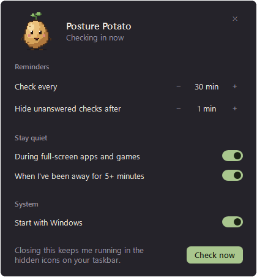

# Posture Potato

A small tray app for Windows and Linux. Every so often a pixel-art potato pops out of the corner of your screen to ask you to check your posture.


## Using it
- **Pop-up:** shows bottom-right of the monitor you're working on, above every app, and never takes keyboard focus.
  - It has one button, **I'm sitting up**. The potato straightens up and cheers, and the next check is one full interval away.
  - If you leave it alone, it hides when the thin bar runs out, and the next check is still one interval away. Hovering over the card holds the bar.

  

- **Tray icon** (Windows: the taskbar's hidden icons; Linux: any system tray that supports StatusNotifier, such as KDE, Xfce, Cinnamon, or GNOME with the AppIndicator extension):
  - Click opens Settings.
  - The menu has the status, Check now, Pause reminders (30 min / 1 hour / until tomorrow 6:00) or Resume, Settings, and Quit. It's the system's own menu.
  - Starting the app again while it's already running opens Settings. On a Linux desktop without a tray, that's how you get back to Settings, and Settings has a Quit button there.

- **Settings** apply straight away:
  - Check interval: 5–180 min.
  - How long an unanswered pop-up stays up.
  - Stay quiet during full-screen apps and games.
  - Pause while you're away for 5+ min.
  - Start with Windows / Start when I log in.

  

- **Stays quiet on its own:** when the PC is locked or asleep (the countdown restarts when you're back), and after 5+ minutes away (coming back counts as a fresh start).
- **Findable in search:** each launch makes sure there's a "Posture Potato" entry in the Start menu (Windows) or the app menu (Linux, `~/.local/share/applications`), and repoints it if the app has moved.
- **Start at login:** every launch checks the startup entry against your saved choice, and re-adds or repoints it if it's missing or stale, so startup repairs itself. Turning it off in the system's own startup settings is respected.
  - Windows: the per-user Run key (Task Manager's Startup apps).
  - Linux: `~/.config/autostart/posture-potato.desktop` (your desktop's startup applications).
- **Don't test it from a sandboxed (MSIX) app's shell**, such as Claude Desktop's: anything launched from there writes its settings and Run key into that app's private copy of AppData and the registry, which Windows startup never sees. Launch it from Explorer, the Start menu or a normal terminal.

### Where things are saved

| | Windows | Linux |
|---|---|---|
| Settings | `%APPDATA%\PosturePotato\settings.json` | `~/.config/posture-potato/settings.json` |
| Startup log | `%APPDATA%\PosturePotato\startup.log` | `~/.local/state/posture-potato/startup.log` |

Settings are saved the moment you change them. If a save fails, Settings says so and the reason goes in the startup log. The log records each start (version, desktop, arguments, working folder, time since boot), which Linux features this desktop supports, reminders shown and answered, hand-offs to a copy that's already running, crashes, session endings and exits. If the app ever goes missing after a reboot, check it first. It trims itself to about 64 KB.

### What works on which Linux desktop

| Feature | GNOME (Wayland or X11) | Other X11 desktops | Other Wayland desktops |
|---|---|---|---|
| Pause while away | yes (GNOME idle monitor) | yes (X screen saver extension) | no: not exposed to apps |
| Quiet during full screen | X11 only | yes | no: not exposed to apps |
| Hide while locked | yes (logind / screen saver) | yes (logind / screen saver) | yes (logind) |
| Tray icon | with the AppIndicator extension | yes | yes on KDE |

Where a desktop can't tell the app something, that feature just stays out of the way. The startup log's "linux probes" line says what was found.

## Build and run
You need the .NET 8 SDK. The UI is [Avalonia](https://avaloniaui.net/) 11, so one codebase builds for both systems.

**Windows** (uses the installed .NET 8 runtime):

```powershell
cd src
dotnet publish -c Release -r win-x64 --self-contained false -p:PublishSingleFile=true -o ..\app
..\app\PosturePotato.exe
```

**Linux** (self-contained, so the target machine needs no .NET; can be built on Windows):

```powershell
cd src
dotnet publish -c Release -r linux-x64 --self-contained true -p:PublishSingleFile=true -o ..\app-linux
```

Copy `app-linux/PosturePotato` somewhere permanent (for example `~/.local/bin/` or `/opt/posture-potato/`), `chmod +x` it and run it once. It adds its own app-menu entry, icon and login entry from there. It needs the usual X11 client libraries (`libx11-6`, `libice6`, `libsm6`, `libfontconfig1`; `libxss1` for idle time on X11), which desktop installs already have. On Wayland it runs through XWayland.

On first launch it turns on start at login and opens Settings. If it's already running, stop it before republishing, because the exe is locked while it runs.

- **Test flags:**
  - `--check-now` shows a pop-up at launch.
  - `--settings` opens Settings at launch.
  - `--export-icon <path.ico>` redraws the app icon (`src\potato.ico`) from the sprite.
- **Rendering:** Linux uses Avalonia's CPU renderer. Two small windows at 12 fps don't need the GPU, and it avoids OpenGL driver trouble (stalled frames, black transparent windows).
- **Size:** about 27 MB on Windows and 88 MB on Linux (that build carries its own .NET runtime). No CPU between checks; memory is trimmed after each window closes.

## Look
- **Potato:** pixel art, a 32×32 sprite on a 40×46 canvas that leaves headroom for hops and sparkles. It's drawn at 3× in the pop-up and 2× in settings, rounded to whole device pixels on each monitor. Animations step at 12 fps and move in whole art pixels.
- **Theme:** one muted surface (#25232A) with hairline borders, Segoe UI Variable on Windows and the bundled Inter elsewhere. Sage (#A9C68E) is used only for the main button and "on" toggles.


## Files (`src/`)
- `PotatoArt.cs`: the sprite. Body shape, palette, faces, arms, sprout, sparkles.
- `PotatoView`: the frame clock and animation verbs (entrance, idle, wave, celebrate, exit).
- `Theme.axaml`: palette, type and every control style.
- `ReminderWindow`: the pop-up.
- `SettingsWindow`: the settings window.
- `Tray.cs`: the tray icon and menu.
- `IconFactory.cs`: the app and tray icons (ICO and PNG) drawn from the sprite.
- `Scheduler.cs`: when to show the pop-up (lock, sleep, away and full-screen aware).
- `Settings.cs`: saved settings.
- `Integration.cs`: start at login, and the Start menu / app menu entry.
- `Platform.cs`: idle, full-screen, monitor and window calls (Win32 on Windows).
- `PlatformLinux.cs`: the same for Linux (X11 and D-Bus).
- `SingleInstance.cs`: one copy per user; a second launch opens Settings.
- `Tween.cs`: the small animation and countdown helpers.
- `Diagnostics.cs`: the startup log.
- `App.axaml.cs` and `Program.cs`: startup and wiring.
